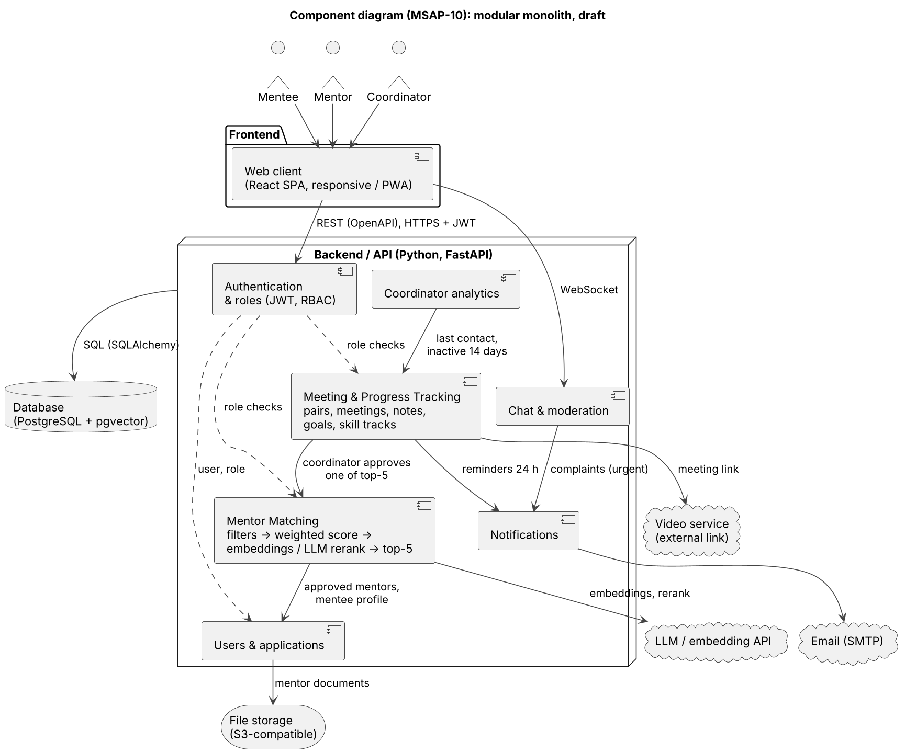
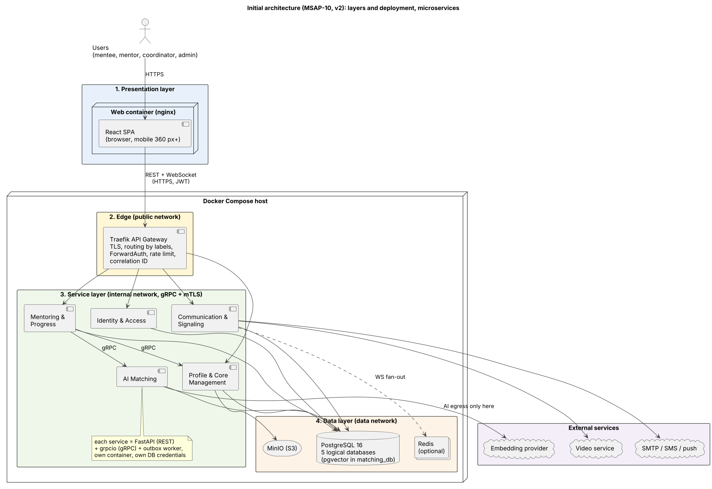

# MSAP-10: Component Diagram and Initial Architecture

## 1. Overview

The Mentoring and Social Adaptation Platform connects mentees, mentors, coordinators, and administrators in one digital environment.

The system follows a **modular monolith architecture**. It uses a single Python FastAPI backend divided into modules with clear responsibilities, one PostgreSQL database, and a React web client.

This architecture keeps development, testing, and deployment manageable for a three-person team while allowing individual modules to be extracted into separate services in the future if necessary.

## 2. Architecture Layers

| Layer        | Technology        | Responsibility |
|--------------|-------------------|----------------------------------------|
| Presentation | React, TypeScript | User interface and client interactions |
| Application  | Python, FastAPI, Uvicorn, Docker | Business logic, API endpoints, authorization, and background jobs |
| Data         | PostgreSQL, pgvector, S3-compatible storage | Structured data, semantic matching, and document storage |

External services include SMTP for email, an LLM and embedding API for mentor matching, and an external video service for meeting links.

## 3. Component Diagram

The component diagram illustrates the main modules of the platform and their interactions within the FastAPI modular monolith.

## 4. Initial Architecture

The application consists of three layers: presentation, application, and data. The React client is hosted separately, while the FastAPI backend runs in a Docker container and communicates with PostgreSQL, object storage, and external services.

## 5. Main Components

### Frontend

The React and TypeScript web client provides role-specific interfaces for mentees, mentors, coordinators, and administrators. It supports applications, document uploads, chat, meeting schedules, goals, skill tracks, and coordinator dashboards.

### Backend API

The FastAPI application is the single entry point for business logic. It provides REST endpoints, WebSocket communication, data validation, authorization, and background processing.

### Authentication and RBAC

The authentication module manages registration, login, JWT tokens, and role-based access control. Access to protected operations is checked on the server.

### Users and Applications

This module manages user profiles, mentor applications, document uploads, and coordinator approval or rejection of applications.

### Mentor Matching

The matching module filters approved mentors by availability, location or online format, and active-pair limits. It calculates weighted scores using criteria such as shared interests and schedule compatibility. Profile embeddings and an LLM reranker can improve recommendations. If the LLM is unavailable, the weighted baseline ranking is used.

The system returns the top five recommendations with per-criterion scores for coordinator review (FR-05).

### Meeting and Progress Tracking

This module manages mentoring pairs, meetings, meeting notes, personal goals, skill tracks, and progress records. It also supports reminders 24 hours before meetings and alerts when a pair has had no contact for 14 days (FR-06, FR-09, FR-10, FR-11).

### Chat and Moderation

The chat module supports real-time messaging within active mentoring pairs and provides complaint reporting and moderation features (FR-07, FR-08).

### Notifications and Coordinator Analytics

Notifications are delivered through email and in-app channels. Coordinator analytics provides information about meeting activity, last contact dates, and inactive pairs.

### Database and File Storage

PostgreSQL stores users, profiles, pairs, meetings, messages, complaints, goals, progress records, notifications, and audit logs. The pgvector extension supports semantic similarity search. Uploaded documents are stored in S3-compatible storage, while the database stores their keys and metadata.

## 6. External Integrations

| Service               | Purpose |
|-----------------------|------------------|
|     SMTP              | Email notifications and reminders |
| LLM API               | Mentor recommendation reranking and explanations |
| Embedding API         | Semantic vectors for profile matching |
| S3-compatible storage | Uploaded documents |
| External video service| Meeting links |

The platform should handle external service failures gracefully. In particular, mentor matching falls back to the weighted baseline score when the LLM service is unavailable.

## 7. Key Scenario: Forming a Mentoring Pair

1. The coordinator opens a mentee profile.
2. The frontend requests mentor recommendations from the backend.
3. Mentor Matching returns the top five candidates with scores.
4. The coordinator selects a mentor.
5. Meeting and Progress Tracking verifies eligibility and creates the pair.
6. The pair is stored in PostgreSQL.
7. Notifications inform the mentor and mentee.
8. The coordinator monitors meetings, goals, and progress through the dashboard.

## 8. Security and Non-Functional Requirements

The system uses HTTPS, JWT-based authentication, role-based access control, and server-side permission checks. Passwords are hashed using Argon2id.

The platform must restrict access to sensitive personal data and maintain an audit log of views of minors' profiles (NFR-02). The API performance target is under 500 ms for 95% of requests with 100 concurrent users (NFR-03).

## 9. Deployment and Maintainability

The React client is deployed to static hosting. The FastAPI application runs in Docker, while PostgreSQL and S3-compatible storage provide persistent data and file storage.

The modular monolith simplifies deployment and maintenance for the current team size. Clear module boundaries allow future extraction of components such as Mentor Matching if scaling requirements justify it.

## 10. Conclusion

The proposed architecture combines React, TypeScript, FastAPI, PostgreSQL with pgvector, and S3-compatible file storage. It provides a modular foundation for secure mentoring management, communication, and social adaptation tracking while keeping the system practical to develop and maintain.
